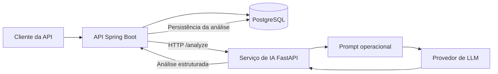

# DeskMind AI

<p align="center">
  <strong>Gestão de chamados e triagem inteligente com IA</strong><br />
  Uma aplicação que combina uma API de gerenciamento de chamados com um serviço de inteligência artificial para organizar solicitações de suporte e gerar sugestões iniciais de atendimento.
</p>

<p align="center">
  
  
  
  
  
  
</p>

---

## Visão geral

**DeskMind AI** é um projeto em desenvolvimento que busca aprimorar a triagem inicial de chamados de suporte de TI.

A aplicação recebe e armazena solicitações de suporte e utiliza um serviço de análise baseado em inteligência artificial para identificar a categoria e a prioridade de cada chamado. Além disso, gera um resumo, explica a classificação realizada e sugere uma resposta que pode auxiliar o profissional responsável pelo atendimento.

O objetivo é tornar a etapa inicial do suporte mais organizada e consistente, mantendo o histórico das análises disponível para consulta.

> **Status do projeto:** o backend e a integração com o serviço de análise por IA estão em desenvolvimento ativo. Uma interface frontend e um fluxo de revisão humana ainda não fazem parte da implementação atual.

## Como funciona

1. Um chamado é criado por meio da API REST desenvolvida com Spring Boot.
2. O backend em Java envia o título e a descrição do chamado para o serviço de análise em Python.
3. O serviço de IA avalia a solicitação com base em diretrizes operacionais de suporte.
4. O modelo retorna uma análise estruturada.
5. O backend Java armazena a análise no PostgreSQL e disponibiliza os dados por meio da API.

## Arquitetura

O projeto está organizado em dois serviços de backend independentes. A aplicação Java é responsável pelo gerenciamento dos chamados e pela persistência dos dados, enquanto o serviço em Python realiza as análises com inteligência artificial.



### Serviços

| Serviço | Responsabilidade | Principais tecnologias |
|---|---|---|
| **Backend API** | Gerenciamento do ciclo de vida dos chamados, endpoints REST, persistência e comunicação com o serviço de IA | Java 25, Spring Boot, Spring Data JPA, Spring RestClient, Flyway |
| **Serviço de IA** | Validação de entrada, análise dos chamados e geração de respostas estruturadas | Python 3.12, FastAPI, Pydantic, LangChain, API da Groq |
| **Banco de dados** | Armazenamento dos chamados e do histórico de análises | PostgreSQL |

## Análise com inteligência artificial

Cada análise de chamado retorna as seguintes informações:

| Campo | Descrição |
|---|---|
| `category` | Classificação do chamado |
| `priority` | Nível de prioridade sugerido |
| `summary` | Resumo do problema relatado |
| `suggestedResponse` | Resposta sugerida para o profissional de suporte |
| `reasoning` | Justificativa para a classificação realizada |

### Categorias disponíveis

- `GENERAL` — dúvidas gerais e solicitações diversas.
- `TECHNICAL` — bugs, erros, problemas de desempenho e falhas de integração.
- `BILLING` — cobranças, notas fiscais, pagamentos e assinaturas.
- `ACCESS` — problemas de login, senha e permissões de acesso.

### Níveis de prioridade

| Prioridade | Significado |
|---|---|
| `LOW` | Dúvidas gerais, solicitações de melhoria e ajustes sem urgência |
| `MEDIUM` | Problemas parciais ou situações que possuem uma alternativa temporária |
| `HIGH` | Funcionalidade principal indisponível e sem alternativa de contorno |
| `URGENT` | Incidentes críticos, com impacto amplo ou interrupção de atividades essenciais |

O serviço de IA utiliza um esquema de saída estruturada com valores predefinidos para categoria e prioridade. Isso mantém o formato da resposta previsível para o backend Java e permite que as análises sejam persistidas de maneira consistente.

O prompt de análise também aplica diretrizes operacionais, como não solicitar senhas dos usuários, evitar promessas sem fundamento e pedir informações relevantes para diagnóstico quando necessário.

## Funcionalidades implementadas

- Criar, consultar e listar chamados de suporte.
- Atualizar o status de um chamado.
- Solicitar uma análise de IA para um chamado.
- Classificar chamados por categoria e prioridade.
- Gerar resumo, justificativa e sugestão de resposta.
- Armazenar as análises e consultar o histórico de cada chamado.
- Validar dados de entrada com Jakarta Validation e Pydantic.
- Gerenciar alterações no esquema do banco de dados com Flyway.
- Realizar a comunicação HTTP entre os serviços Java e Python.

## Referência da API

Os endpoints abaixo estão disponíveis na implementação atual do backend.

### Chamados

| Método | Endpoint | Descrição |
|---|---|---|
| `POST` | `/api/v1/tickets` | Criar um chamado |
| `GET` | `/api/v1/tickets` | Listar chamados |
| `GET` | `/api/v1/tickets/{id}` | Consultar um chamado |
| `PATCH` | `/api/v1/tickets/{id}/status` | Atualizar o status de um chamado |

### Análise dos chamados

| Método | Endpoint | Descrição |
|---|---|---|
| `POST` | `/api/v1/tickets/{ticketId}/analyses` | Solicitar uma nova análise por IA |
| `GET` | `/api/v1/tickets/{ticketId}/analyses` | Listar as análises de um chamado |

### Serviço de IA

| Método | Endpoint | Descrição |
|---|---|---|
| `GET` | `/health` | Verificar a saúde do serviço |
| `POST` | `/analyze` | Analisar um chamado |

### Exemplo: criar um chamado

```http
POST /api/v1/tickets
Content-Type: application/json
```

```json
{
  "title": "Não consigo acessar a plataforma",
  "description": "Recebo uma mensagem de erro ao tentar fazer login."
}
```

Utilize o ID do chamado retornado pela API para solicitar uma análise:

```http
POST /api/v1/tickets/{ticketId}/analyses
```

A resposta contém a classificação gerada, a prioridade, o resumo, a sugestão de resposta e a justificativa da análise.

## Tecnologias utilizadas

**Backend**
- Java 25
- Spring Boot
- Spring Web / REST
- Spring Data JPA
- Jakarta Validation
- Spring RestClient

**Serviço de IA**
- Python 3.12
- FastAPI
- Pydantic v2
- LangChain
- API da Groq (interface compatível com a API da OpenAI)

**Dados e ferramentas**
- PostgreSQL
- Flyway
- Maven
- Uvicorn
- Git e GitHub

## Executando localmente

### Pré-requisitos

- Java 25
- Python 3.12
- Banco de dados PostgreSQL
- Git
- Uma chave de API da Groq

### 1. Clone o repositório

```bash
git clone https://github.com/8rick/deskmind-ai.git
cd deskmind-ai
```

### 2. Configure o serviço de IA

Crie e ative um ambiente virtual:

```bash
python -m venv .venv
```

No Windows:

```powershell
.venv\Scripts\Activate.ps1
```

No macOS/Linux:

```bash
source .venv/bin/activate
```

Instale as dependências:

```bash
pip install -r requirements.txt
```

Crie um arquivo de ambiente local a partir do modelo:

```bash
cp .env.example .env
```

No Windows PowerShell:

```powershell
Copy-Item .env.example .env
```

Configure sua chave da Groq no arquivo `.env`:

```env
GROQ_API_KEY=sua_chave_de_api_groq
LLM_BASE_URL=https://api.groq.com/openai/v1
LLM_MODEL=llama-3.3-70b-versatile
```

Inicie o serviço de IA:

```bash
uvicorn app.main:app --reload --port 8001
```

O serviço ficará disponível em `http://localhost:8001`. O endpoint de verificação de saúde estará em `http://localhost:8001/health`.

### 3. Configure o PostgreSQL e o backend Java

Crie um banco de dados PostgreSQL e disponibilize as seguintes variáveis de ambiente para a aplicação Java:

```env
DATABASE_URL=jdbc:postgresql://localhost:5432/deskmind
DATABASE_USER=seu_usuario
DATABASE_PASSWORD=sua_senha
```

O backend utiliza o Flyway para aplicar as migrações do banco de dados durante a inicialização. A configuração atual espera que o serviço de IA esteja disponível em `http://localhost:8001`.

Em um segundo terminal, execute:

```bash
cd deskmind-backend
./mvnw spring-boot:run
```

No Windows:

```powershell
.\mvnw.cmd spring-boot:run
```

A API ficará disponível em `http://localhost:8080`.

### 4. Documentação da API

Com o backend em execução, acesse a interface do Swagger:

[`http://localhost:8080/swagger-ui/index.html`](http://localhost:8080/swagger-ui/index.html)

> Mantenha as credenciais em variáveis de ambiente locais. Não envie seu arquivo `.env` para o repositório nem exponha chaves de API.

## Roadmap

O projeto está evoluindo em etapas. Entre as melhorias planejadas estão:

- [ ] Implementar revisão humana das análises geradas pela IA, com fluxo de aprovação e rejeição.
- [ ] Implementar RAG (Retrieval-Augmented Generation) com uma base de conhecimento para gerar sugestões contextualizadas.
- [ ] Desenvolver uma interface frontend para gerenciamento de chamados e revisão das análises.
- [ ] Ampliar os testes automatizados e a cobertura de testes de integração.
- [ ] Aprimorar a observabilidade e o tratamento de erros operacionais.

## Estrutura do repositório

```text
deskmind-ai/
├── app/                         # Serviço de IA em Python
│   ├── analyzer.py              # Prompt, integração com LLM e cadeia de análise
│   ├── main.py                  # Aplicação FastAPI e rotas
│   └── schemas.py               # Esquemas Pydantic de requisição e resposta
├── deskmind-backend/            # Backend Java
│   ├── src/main/java/           # API REST, domínio e serviços da aplicação
│   └── src/main/resources/
│       ├── application.properties
│       └── db/migration/         # Migrações do Flyway
├── .env.example                 # Modelo das variáveis de ambiente
├── requirements.txt             # Dependências do Python
└── README.md
```

## Sobre

O DeskMind AI é um projeto independente de desenvolvimento de software criado por [Rickelmy Barbosa da Silva](https://github.com/8rick).

O repositório é público e está aberto a feedbacks, sugestões e discussões técnicas.

---

<p align="center">
  <sub>DeskMind AI · Triagem inteligente de chamados</sub>
</p>
