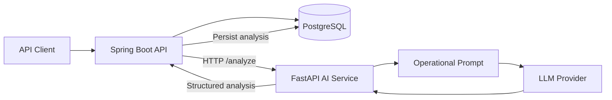

# DeskMind AI

<p align="center">
  <strong>Intelligent ticket management and support triage</strong><br />
  An application that combines a ticket management API with an AI service to organize support requests and generate actionable first-response suggestions.
</p>

<p align="center">
  
  
  
  
  
  
</p>

---

## Overview

**DeskMind AI** is a project in development focused on improving the initial triage of IT support tickets.

The application receives support requests, stores them, and uses an AI-powered analysis service to identify the ticket category and priority. It also generates a concise summary, explains the classification, and suggests a response that can help a support agent handle the request.

The goal is to make the first stage of support more organized and consistent while keeping the analysis available for later review.

> **Project status:** the backend and AI analysis integration are under active development. A frontend interface and human review workflow are not yet part of the current implementation.

## How it works

1. A ticket is created through the Spring Boot REST API.
2. The Java backend sends the ticket title and description to the Python analysis service.
3. The AI service evaluates the request using operational support guidelines.
4. The model returns a structured analysis.
5. The Java backend stores the analysis in PostgreSQL and makes it available through the API.

## Architecture

The project is organized into two independent backend services. The Java application owns ticket management and persistence, while the Python service is responsible for AI-powered analysis.



### Services

| Service | Responsibility | Main technologies |
|---|---|---|
| **Backend API** | Ticket lifecycle, REST endpoints, persistence and communication with the AI service | Java 25, Spring Boot, Spring Data JPA, Spring RestClient, Flyway |
| **AI Service** | Input validation, ticket analysis and structured response generation | Python 3.12, FastAPI, Pydantic, LangChain, Groq API |
| **Database** | Stores tickets and their analysis history | PostgreSQL |

## AI analysis

Each ticket analysis returns the following information:

| Field | Description |
|---|---|
| `category` | Ticket classification |
| `priority` | Suggested urgency level |
| `summary` | Short description of the reported issue |
| `suggestedResponse` | Suggested message for the support agent |
| `reasoning` | Explanation for the classification |

### Supported categories

- `GENERAL` — general questions and requests.
- `TECHNICAL` — bugs, errors, performance and integration issues.
- `BILLING` — invoices, charges, payment and subscription matters.
- `ACCESS` — login, password and permission issues.

### Priority levels

| Priority | Meaning |
|---|---|
| `LOW` | General questions, improvement requests and non-urgent adjustments |
| `MEDIUM` | Partial issues or situations with a workaround |
| `HIGH` | Main functionality unavailable without a workaround |
| `URGENT` | Critical incidents, broad impact or business-critical disruption |

The AI service uses a structured output schema with predefined category and priority values. This keeps the response predictable for the Java backend and allows the analysis to be persisted consistently.

The analysis prompt also applies operational guidelines, such as not requesting user passwords, avoiding unsupported promises, and asking for relevant diagnostic details when needed.

## Current capabilities

- Create, retrieve and list support tickets.
- Update ticket status.
- Request an AI analysis for a ticket.
- Classify tickets by category and priority.
- Generate a summary, reasoning and suggested response.
- Persist ticket analyses and retrieve their history.
- Validate incoming data with Jakarta Validation and Pydantic.
- Manage database schema changes with Flyway.
- Communicate between Java and Python services over HTTP.

## API reference

The endpoints below are available in the current backend implementation.

### Tickets

| Method | Endpoint | Description |
|---|---|---|
| `POST` | `/api/v1/tickets` | Create a ticket |
| `GET` | `/api/v1/tickets` | List tickets |
| `GET` | `/api/v1/tickets/{id}` | Retrieve a ticket |
| `PATCH` | `/api/v1/tickets/{id}/status` | Update ticket status |

### Ticket analysis

| Method | Endpoint | Description |
|---|---|---|
| `POST` | `/api/v1/tickets/{ticketId}/analyses` | Request a new AI analysis |
| `GET` | `/api/v1/tickets/{ticketId}/analyses` | List analyses for a ticket |

### AI service

| Method | Endpoint | Description |
|---|---|---|
| `GET` | `/health` | Check service health |
| `POST` | `/analyze` | Analyze a ticket |

### Example: create a ticket

```http
POST /api/v1/tickets
Content-Type: application/json
```

```json
{
  "title": "Unable to access the platform",
  "description": "I receive an error when trying to sign in."
}
```

Use the returned ticket ID to request an analysis:

```http
POST /api/v1/tickets/{ticketId}/analyses
```

The response contains the generated classification, priority, summary, suggested response and reasoning.

## Technology stack

**Backend**
- Java 25
- Spring Boot
- Spring Web / REST
- Spring Data JPA
- Jakarta Validation
- Spring RestClient

**AI service**
- Python 3.12
- FastAPI
- Pydantic v2
- LangChain
- Groq API (OpenAI-compatible interface)

**Data and tooling**
- PostgreSQL
- Flyway
- Maven
- Uvicorn
- Git and GitHub

## Running locally

### Prerequisites

- Java 25
- Python 3.12
- PostgreSQL database
- Git
- A Groq API key

### 1. Clone the repository

```bash
git clone https://github.com/8rick/deskmind-ai.git
cd deskmind-ai
```

### 2. Configure the AI service

Create and activate a virtual environment:

```bash
python -m venv .venv
```

On Windows:

```powershell
.venv\Scripts\Activate.ps1
```

On macOS/Linux:

```bash
source .venv/bin/activate
```

Install dependencies:

```bash
pip install -r requirements.txt
```

Create a local environment file from the example:

```bash
cp .env.example .env
```

On Windows PowerShell:

```powershell
Copy-Item .env.example .env
```

Set your Groq API key in `.env`:

```env
GROQ_API_KEY=your_groq_api_key
LLM_BASE_URL=https://api.groq.com/openai/v1
LLM_MODEL=llama-3.3-70b-versatile
```

Start the AI service:

```bash
uvicorn app.main:app --reload --port 8001
```

The service will be available at `http://localhost:8001`. Its health endpoint is `http://localhost:8001/health`.

### 3. Configure PostgreSQL and the Java backend

Create a PostgreSQL database and provide the following environment variables to the Java application:

```env
DATABASE_URL=jdbc:postgresql://localhost:5432/deskmind
DATABASE_USER=your_database_user
DATABASE_PASSWORD=your_database_password
```

The backend uses Flyway to apply the database migrations on startup. The current configuration expects the AI service at `http://localhost:8001`.

In a second terminal, run:

```bash
cd deskmind-backend
./mvnw spring-boot:run
```

On Windows:

```powershell
.\mvnw.cmd spring-boot:run
```

The API will be available at `http://localhost:8080`.

### 4. API documentation

When the backend is running, access the Swagger UI:

[`http://localhost:8080/swagger-ui/index.html`](http://localhost:8080/swagger-ui/index.html)

> Keep credentials in local environment variables. Do not commit your `.env` file or expose API keys in the repository.

## Roadmap

The project is evolving in incremental stages. Planned improvements include:

- [ ] Human review of AI-generated analyses, with approval and rejection flow.
- [ ] Retrieval-Augmented Generation (RAG) with a knowledge base for context-aware suggestions.
- [ ] Frontend interface for ticket management and analysis review.
- [ ] Expanded automated tests and integration coverage.
- [ ] Improved observability and operational error handling.

## Repository structure

```text
deskmind-ai/
├── app/                         # Python AI service
│   ├── analyzer.py              # Prompt, LLM integration and analysis chain
│   ├── main.py                  # FastAPI application and routes
│   └── schemas.py               # Pydantic request and response schemas
├── deskmind-backend/            # Java backend
│   ├── src/main/java/           # REST API, domain and application services
│   └── src/main/resources/
│       ├── application.properties
│       └── db/migration/         # Flyway migrations
├── .env.example                 # Environment variable template
├── requirements.txt             # Python dependencies
└── README.md
```

## About

DeskMind AI is an independent software development project created by [Rickelmy Barbosa da Silva](https://github.com/8rick).

The repository is public and open to feedback, suggestions and technical discussions.

---

<p align="center">
  <sub>DeskMind AI · Intelligent support triage</sub>
</p>
